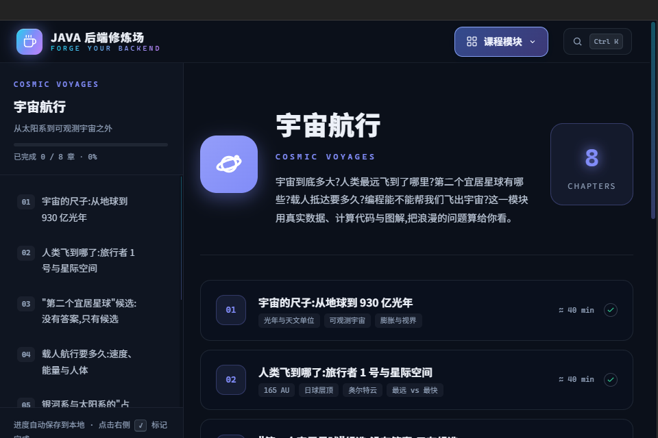

# Java 后端修炼场 · 阅读与实验版

零构建的 Java 后端学习站，阅读和代码运行均在浏览器内完成，只需 HTTP(S) 静态托管。当前为 **19 个模块、153 章、153 个对应练习、约 116 万正文字符、358 道面试题**。页面注册了 74 张 SVG 图解和 45 个知识交互演示，另有 6 个课程窗口模型和逆向 18 章免环境实验入口；课程正文使用其中 68 处图解引用、42 处知识演示引用，注册数量与引用数量并不相同。

## 界面截图

| 首页 | 模块页 |
| --- | --- |
|  |  |

> 截图来自本地静态预览，960×640 视口；课程运行器在浏览器内执行代码。

## 启动

把整个目录（包括 `assets/vendor/`）部署到任意 HTTP(S) 静态网站即可使用。访客无需安装 JDK、Python、数据库或本机执行服务；源码在浏览器 Worker / WebAssembly / 网页 JVM 中编译运行，不会提交给服务器执行。

维护者如需本地预览，可以使用任意静态服务器。例如可选的 `python scripts/serve.py` 仅提供静态文件，默认地址为 http://127.0.0.1:8766/#/playground 。此命令不是访客运行代码的前提；它没有执行 API，不启动 javac/java/Python 子进程。直接双击 `index.html` 可阅读，但浏览器的 file:// 限制会阻止 Worker 和运行时资源加载，请通过网站访问。

网站内置约 69 MB 运行时资源：Java 首次约 42 MB，Python 首次约 14 MB，按所选语言加载，后续由 HTTP 缓存复用。执行时无需 CDN；部署时应保留 WebAssembly MIME 类型 `application/wasm`，并缓存 `assets/vendor/`。来源和许可证见 [运行时说明](assets/vendor/README.md)。课程中教安装工具的章节保留为学习内容，与网页运行按钮无关。

## 网页代码与图形窗口

具体支持范围与验证记录见 [运行能力报告](docs/runtime-report.md)。

从“模块”菜单进入 **模拟实验总览 `#/simulations`**。排序支持自定义数组、单步回退、伪代码同步和状态计数；逆向 18 章都有无需目标软件的教学实验。课程代码/配置块提供逐行释义，TEXT 块仅展示和复制。逆向原理实验每章一个，位于对应小节并就地展开，不在每个代码块重复添加入口。详细覆盖清单、模型边界和验证记录见 [浏览器实验报告](docs/browser-labs-report.md)。

- 正文代码旁可打开带实时语法高亮的编辑/运行区，修改源码，查看真正的输出、异常和编译错误。标准输入、程序参数按当前源码的实际引用显示；主类可直接确定时隐藏选择项,多个入口或入口位于其他类中时显示。编辑代码后同步更新,隐藏项的旧值不传给运行器。
- Java：网站内置 Doppio JVM、Java 8 标准库和编译器，支持独立单文件、语句片段、输入、参数与主类选择。Java 9～21 新语法及 Spring 等外部依赖尚不支持，真实编译错误会显示。
- Python：网站内置 Pyodide / WebAssembly 和标准库，支持输入、参数、虚拟文件与异常反馈；不自动安装第三方包。
- JavaScript：在浏览器 Worker 真实执行，可用 console.log/input/args，无 DOM；10 秒超时终止。
- HTML/SVG：在 sandbox iframe 实际预览，支持内联 CSS/JS，禁止网络访问、表单与弹窗。
- SQL：使用网站内置 sql.js / WebAssembly，每次新建 SQLite 内存库；支持建表、插入、查询与表格输出，**不等同于 MySQL**，不能验证 MySQL 专有锁、存储引擎或用户权限。
- 课程窗口：Java 简史第 5 章的计算器、JavaFX 倒计时、弹跳小球，以及第 3 章的移动方块、MIDlet 生命周期和 RecordStore，均有可操作模型。模拟按这六个示例的逻辑制作，不执行 JVM GUI，也不支持把任意 GUI 源码自动变成窗口。
- Shell、配置、框架片段等展示环境说明；没有用预设输出冒充任意代码的执行结果。

## 编程与真实世界

入口 `#/m/world`：新增 14 章、15 个网页图形实验和 172 个源码语义检查点，约 3.8 万字符讲解，加上独立可执行代码约 6.2 万字符。可调参数、逐步回放、暂停、复位，并在独立 Worker 修改运行相同算法；原有 14 个实验的默认与变更参数共 28 次浏览器执行已核对，新增启动实验另验证 4 种运行情形。

第一章从嵌入式计算机讲起，解释 CPU 与操作系统、裸机与 RTOS、复位入口、启动例程、固件与 Flash/RAM、交叉编译、外设寄存器与中断。新增实验可切换裸机/RTOS、关闭中断、拒绝无效镜像，对照两条启动路径、状态和高亮源码；这是网页语义模型，不是具体芯片或真实 RTOS 的指令级仿真。

起搏器、医疗互锁、千年虫、阿丽亚娜 501、火星轨道器、计时误差、阿波罗调度、光时、纠错、凌日与 SETI、文明档案和综合探测任务均有对应实验。明确区分历史调查、教学模型和思想实验，不将候选当作生命发现，也不虚构“一个回车”说法的出处。详细来源、模型范围和验证见 [模块报告](docs/world-module-report.md)。

可读源在 `lessons/world/`，共享模型在 `assets/js/world-models.js`；修改后运行 `node scripts/build_world_module.js` 与 `node scripts/verify_world_module.js`。

## 内容地图

| 模块 | 章数 | 学习重点 |
| --- | ---: | --- |
| JavaSE 核心基础 | 15 | 新增安装运行、变量循环、方法对象三章；语法、集合、IO、并发、函数式 |
| 开发工具与项目实战 | 5 | Maven 完整工程、Git、调试、JUnit、分阶段订单项目 |
| Java 简史与生态 | 5 | 版本史、ME/SE/EE、桌面与游戏 |
| 数据结构与算法 | 5 | 复杂度、线性结构、树、图、算法思想 |
| 计算机网络 | 5 | 分层、HTTP/TLS/DNS、TCP/IP、排障 |
| 操作系统 | 5 | 进程线程、调度、虚拟内存、文件与 IO |
| MySQL | 9 | SQL 入门、索引、事务、MVCC、锁与日志 |
| 原生 Java Web | 6 | Tomcat、Servlet、会话、Filter、MVC、JDBC |
| JVM | 8 | 类加载、内存、对象、GC、诊断与 OOM |
| Spring 全家桶 | 13 | IoC/AOP/事务/MVC、Boot/Starter/配置部署、MyBatis |
| Redis | 9 | 类型、线程模型、持久化、缓存、锁、集群 |
| 消息队列 | 4 | RabbitMQ、Kafka、可靠消息与幂等 |
| Linux | 6 | 登录、文件权限、文本、性能、部署、Shell |
| Nginx 与 Spring Cloud | 6 | 代理、注册配置、服务调用、网关、熔断与事务 |
| 设计模式 | 7 | 原则、创建/结构/行为模式与源码应用 |
| 前沿技术 | 5 | 区块链、Web3j、AI 工具与验证 |
| 逆向工程 | 18 | 汇编与格式、静态/动态、Java/Android、协议、防御及三套自制样本实验 |
| 编程与真实世界 | 14 | 医疗与起搏器、千年虫、航天事故、深空自治、生命探索、文明与代码传承 |
| **宇宙航行** | **8** | 宇宙尺度、旅行者 1 号、宜居候选、载人航行时间、银河系占比、视界之外、编程的边界、外星通信 |

建议零基础先学 JavaSE 前三章，再学习工程模块的 Maven、Git、调试和测试；SQL 放在 JDBC/Spring 数据访问之前。订单项目按前置知识分阶段完成。真实世界模块可作为零基础兴趣入口；历史、前沿、逆向、真实世界与宇宙航行按兴趣选修，不用把学习期限固定为几周。

## 阅读体验

- 本地 Noto Sans SC 衍生字集字体，正文与代码分设字体、字号、行距；正文支持 16/17/19px 切换。
- 专注阅读、章内目录、章节进度、练习自检进度，以及全文关键词搜索。
- 代码、输出、表格、图解独立横向滚动，避免撑宽整页；提示框内部支持代码块与表格。
- 图解文字按节点宽度适配；省略标签保留完整悬停提示；可打开独立缩放窗口，支持 Esc 关闭与焦点恢复。
- 从“模块”菜单进入图解总览 `#/atlas`，集中浏览全部 74 张图解。
- 遵守系统减少动态效果设置，保留键盘焦点提示。

## 逆向篇补强

原有 15 章均增加针对性的证据推导、实验前提、失败排查和结论限制；新增：

1. **JDK 实验**：自己编写 BytecodeLab，通过 javap 读描述符和操作数栈，通过 jdb 核对调用现场。
2. **文件格式实验**：Python 标准库检查 class/PE 头，自制非可执行夹具，验证截断、越界和未知格式。
3. **协议实验**：离线长度前缀解析器，验证拆分、合并、中文、空消息、超长与非法 UTF-8。

实验以自己的程序与无害数据为对象。原有复杂工具和平台内容仍属于入门/进阶导览，不把覆盖面等同于每个方向都达到专著深度。

## 验证与维护

```shell
node scripts/verify_content.js
node scripts/verify_world_module.js
node scripts/verify_virtual_runtime.js
node scripts/verify_runtime_options.js
node scripts/verify_line_explanations.js
node scripts/verify_highlight.js
python scripts/verify_domain_example.py
python scripts/verify_labs.py
python scripts/verify_runner.py
node scripts/verify_simulations.js
node scripts/verify_browser_labs.js
```

`verify_content.js` 检查 56 个页面脚本语法、章节结构、Markdown 渲染、练习数量和图解/演示引用。`verify_labs.py` 是维护者的课程源码检查，需要 JDK 17、Python 3 与 Maven：验证新增独立 Java 程序、Python 实验、文档中的 Maven 工程和 JUnit 测试；访客网页运行无需这些环境。虚拟运行器检查源码预处理、资源哈希与纯浏览器架构；逐行释义检查语义回归，高亮检查五种语言的着色、原文保留与转义；静态服务器检查无执行 API、WASM 类型与缓存。浏览器执行记录见运行能力报告；模拟检查覆盖课程窗口、排序、字节码、文件头、协议、XOR 与代码覆盖清单。验证在临时目录创建文件，不污染课程目录。

新增课程的可读编辑源保存在 `scripts/build_learning_content.py`、`scripts/build_reverse_labs.py`，修改后重新生成：

```shell
python scripts/build_learning_content.py
python scripts/build_reverse_labs.py
```

网站运行不需要执行生成脚本。`verify_domain_example.py` 是维护者回归检查,验证域名示例的实际输出与正文一致,并覆盖形近字符、全角、大小写及伪装后缀等 14 种输入；网页仍使用内置 Pyodide 执行。字体来源与许可证见 `assets/fonts/README.md`；新增文字后可用 `scripts/subset_font.py` 重建字集（需要 fonttools 和 brotli）。

原有 131 章布局已在 320、390、768、1440px 宽度逐章检查；新增真实世界 14 章已在桌面、390px、320px 检查。具体范围与限制见 `docs/optimization-report.md`。已有内容中的全部代码并未逐一执行，不再宣称所有输出都来自实测；日志、伪代码和依环境变化的结果应按正文说明理解。
