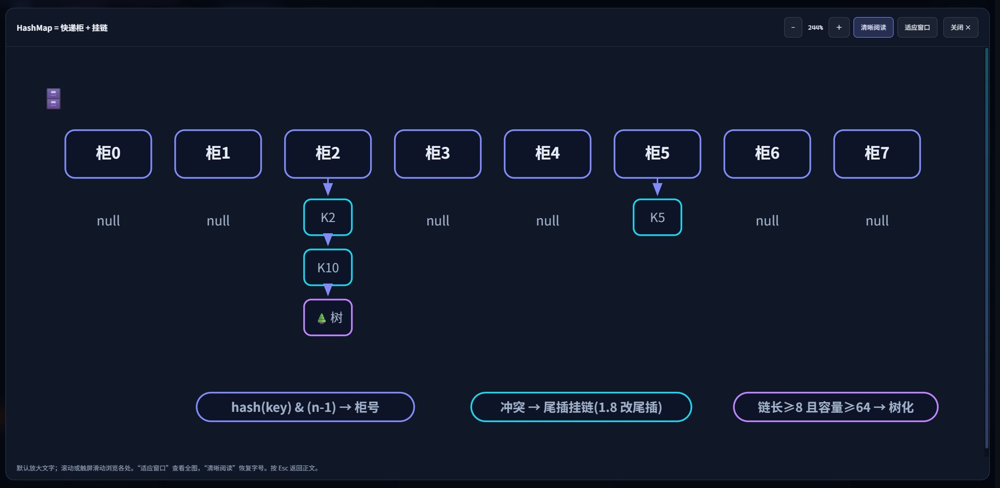
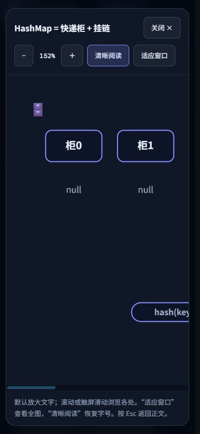

# 图解放大窗口修复

截图中的问题来自两处尺寸限制：正文 SVG 随内容区域放大，弹窗却把它恢复到原始 viewBox 宽度（HashMap 为 800px），同时弹窗最多只有 1400px 宽。因此点“放大查看”反而缩小了图。

## 修改

- 弹窗使用接近整屏的可用宽高，标题、按钮与说明固定在窗口内，图解区域单独滚动。
- 默认尺寸至少为正文图解的 110%，并让最小文字达到 16 CSS 像素；保留 SVG 矢量绘制。
- 增加实时缩放比例、“清晰阅读”复位；加减按钮按 1.25 倍缩放并尽量保持视野中心。
- “适应窗口”同时考虑宽高，可完整查看全图；手机默认保留清晰文字，通过滑动查看细节。
- 关闭后恢复正文滚动和入口焦点；窗口尺寸变化时重新计算清晰阅读/适应窗口模式。

## 浏览器验证

通过真实页面入口检查全站 68 处图解引用：2048×1000 与 390×844 两组视口共 136 次；另外在 320×640 检查 HashMap 与两张 UML 基础图。**139 次全部通过**。

每次检查默认尺寸、最小文字字号、弹窗边界、按钮栏以及适应窗口后的完整 SVG。另验证加减可逆（1219.05 → 1523.80 → 1219.05px）、清晰阅读复位、Esc 关闭与焦点恢复。

逐项数据：[diagram-viewer-validation.json](diagram-viewer-validation.json)。

维护检查：verify_pattern_uml、verify_content、verify_unique_media 与 reading.js 语法检查通过；已重建本地阅读字体并更新缓存版本。

桌面截图：

手机截图：

